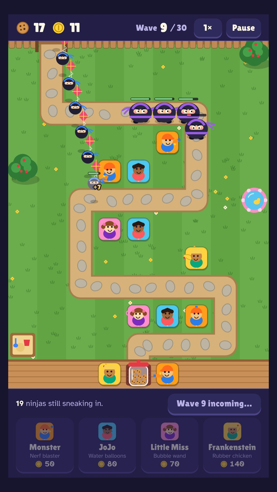

# Cookie Jar Defense

A tower defense game for the kitchen touchscreen. A gang of very silly ninjas sneaks across the backyard to raid the cookie jar, and Monster, JoJo, Little Miss and Frankenstein have to stop them.

**Play it:** https://blklite.github.io/cookie-jar-defense/ (the intro page, with the game in a frame) or [the game on its own](https://blklite.github.io/cookie-jar-defense/game.html).



This is a prototype. It is planned as **K10** of the kitchen screen (Feature #134). The spec is `agent-specs/kitchen-k10-game.md` in the project wiki.

## Play

Open `game.html` in a browser. It is one self-contained file with no build step. A tall window works best; it is laid out for a 1080 × 1920 portrait touchscreen and scales down to a phone.

`index.html` is the intro page: what the game is, the cast, screenshots, and the game itself in a frame.

1. **Pick a kid** at the bottom, then tap the grass to put them there. Kids cost allowance coins.
2. **Start the wave.** Ninjas come through the back gate and follow the garden path to the porch. Each one that gets there eats cookies.
3. **Tap a kid** to upgrade them (3 levels), sell them, or choose who they aim at: first, strongest or closest.
4. **Last 30 waves** with your 20 cookies. After wave 30 you can keep going.

| Kid | Job | Cost |
|---|---|---|
| Monster | Nerf blaster: fast darts, hits kites | 50 |
| JoJo | Water balloons: splash | 80 |
| Little Miss | Bubble wand: slows, up to 3 at level 3 | 70 |
| Frankenstein | Rubber chicken: long range, hits kites, stuns | 140 |

| Ninja | From wave | Trick |
|---|---|---|
| Sneaky | 1 | None |
| Scooter | 3 | Fast |
| Kite | 5 | Flies straight over the yard; only Monster and Frankenstein reach it |
| Sumo | 6 | Tough, half immune to bubbles, eats 3 cookies |
| Smoke Bomb | 8 | Vanishes and pops up further along |
| Grand Sensei | 10, 20, 30 | Splits into 4 ninjas, eats 10 cookies |

A tagged ninja vanishes in a puff of smoke. Nobody gets hurt.

## Kitchen screen mode

When the page is opened from disk (`file:`), as on the kitchen screen:

- a **Week** button goes back to `index.html` in the same folder (the week page on the kiosk);
- 3 minutes with no touch also goes back to the week, even mid-wave.

The best wave is kept in `localStorage`, so on the kiosk's incognito browser it resets each morning.

Before it can ship to the kiosk, `game.html` has to follow the kiosk page rules: a `default-src 'none'` content security policy with the script allowed by hash, and no outside links. Today it loads its display font from Google Fonts. The K10 spec lists this and the other steps.

## Test

```sh
npm install
npm test               # a scripted player plays 10 waves
WAVES=30 npm test      # the full game, a few minutes
```

The test serves this folder, opens `game.html` in headless Chromium at 540 × 960 with touch, and runs a fake clock at 2× speed. It fails on any page error or page scroll. Set `CHROMIUM=/path/to/chrome` to use a browser that is already installed; otherwise run `npx playwright install chromium` first.

**Balance so far:** the scripted player, which spends every coin and places kids well, wins wave 30 with 17 of 20 cookies. It loses its first cookies to the kites of wave 5. No person has played it yet.

## Files

| Path | What |
|---|---|
| `game.html` | The game: HTML, CSS and 1 inline script, about 55 KB |
| `index.html` | The intro page |
| `img/` | Screenshots and the character drawings used by the intro page (the game draws its own) |
| `tests/playthrough.js` | The headless playthrough test |
