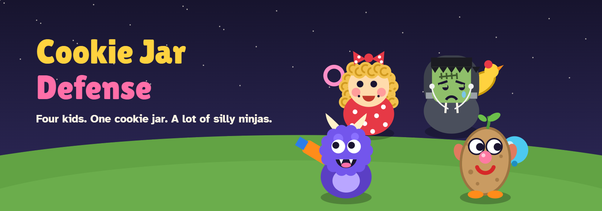

# Cookie Jar Defense

A small tower defense game that kids earn by finishing their chores. A gang of very silly ninjas sneaks across the backyard to raid the cookie jar, and Monster, JoJo, Little Miss and Frankenstein have to stop them.

**Play it:** https://blklite.github.io/cookie-jar-defense/ (the intro page, with the game in a frame) or [the game on its own](https://blklite.github.io/cookie-jar-defense/game.html).


This is a prototype. No real person has played a full game yet.

## Play

Open `game.html` in a browser. It is one self-contained file with no build step. A tall window works best. It is laid out for a 1080 × 1920 portrait touchscreen and scales down to a phone. It also works with a mouse, and a mouse shows each kid's range before you place them.

`index.html` is the intro page: what the game is, the cast, screenshots, and the game itself in a frame.

1. **Pick a kid** at the bottom, then tap the grass to put them there. Kids cost allowance coins. Each tap buys one kid.
2. **Start the wave.** Ninjas come through the back gate and follow the garden path to the porch. Each one that gets there eats cookies.
3. **Tap a kid** to upgrade them (3 levels), sell them, or choose who they aim at: first, strongest or closest.
4. **Last 30 waves** with your 20 cookies. After wave 30 you can keep going.

| Kid | Looks like | Job | Cost |
|---|---|---|---|
| Monster | A round, fuzzy purple monster with stubby horns and a fanged grin | Nerf blaster: fast darts, hits kites | 50 |
| JoJo | A potato creature with googly eyes, stick-on ears and a sprout on top | Water balloons: splash | 80 |
| Little Miss | Blonde ringlet curls and a red polka-dot bow and dress | Bubble wand: slows, up to 3 at level 3 | 70 |
| Frankenstein | A sad teenage monster in a hoodie, with stitches, neck bolts and earbuds | Rubber chicken: long range, hits kites, stuns | 140 |

| Ninja | From wave | Trick |
|---|---|---|
| Sneaky | 1 | None |
| Scooter | 3 | Fast |
| Kite | 5 | Flies straight over the yard; only Monster and Frankenstein reach it |
| Sumo | 6 | Tough, half immune to bubbles, eats 3 cookies |
| Smoke Bomb | 8 | Vanishes and pops up further along |
| Grand Sensei | 10, 20, 30 | Splits into 4 ninjas, eats 10 cookies |

A tagged ninja vanishes in a puff of smoke. Nobody gets hurt.

Your best wave is kept in this browser's `localStorage`. When you open `game.html` straight from disk, a **Home** button goes back to `index.html` in the same folder.

## Test

```sh
npm install
npm test               # a scripted player plays 10 waves
WAVES=30 npm test      # the full game, a few minutes
```

The test serves this folder, opens `game.html` in headless Chromium at 540 × 960 with touch, and runs a fake clock at 2× speed. It fails on any page error or page scroll. Set `CHROMIUM=/path/to/chrome` to use a browser that is already installed (Microsoft Edge works too); otherwise run `npx playwright install chromium` first.

**Balance so far:** the scripted player, which spends every coin and places kids well, wins wave 30 with 17 of 20 cookies. It loses its first cookies to the kites of wave 5.

## Playtest notes

A playtest on 2026-11-07, at phone size and on a desktop, found and fixed these defects:

| Defect | Fix |
|---|---|
| After you placed a kid, that kid stayed selected, so the next tap on the grass bought another one by accident. | Each tap buys one kid. Pick the card again to buy another. |
| Opened from disk, the game jumped to the intro page after 3 minutes with no tap, even in the middle of a wave. | The idle jump is removed. |
| The title screen said "Best today", but the best wave is kept for good. | It now says "Your best". |
| The playthrough test could click the Upgrade button while the kid panel was closing, and stopped at wave 13 or 20. | The test clicks Upgrade only when the button is visible, and a missed click is not a failure. All 30 waves now pass. |

Still open:

- Kids can stand on the top row, partly under the back fence.
- Frankenstein's hood is a plain rounded shape, so at small sizes it reads as a box.

## Files

| Path | What |
|---|---|
| `game.html` | The game: HTML, CSS and 1 inline script, about 60 KB |
| `index.html` | The intro page |
| `img/` | The header, screenshots and the character drawings used by the intro page (the game draws its own) |
| `tests/playthrough.js` | The headless playthrough test |
